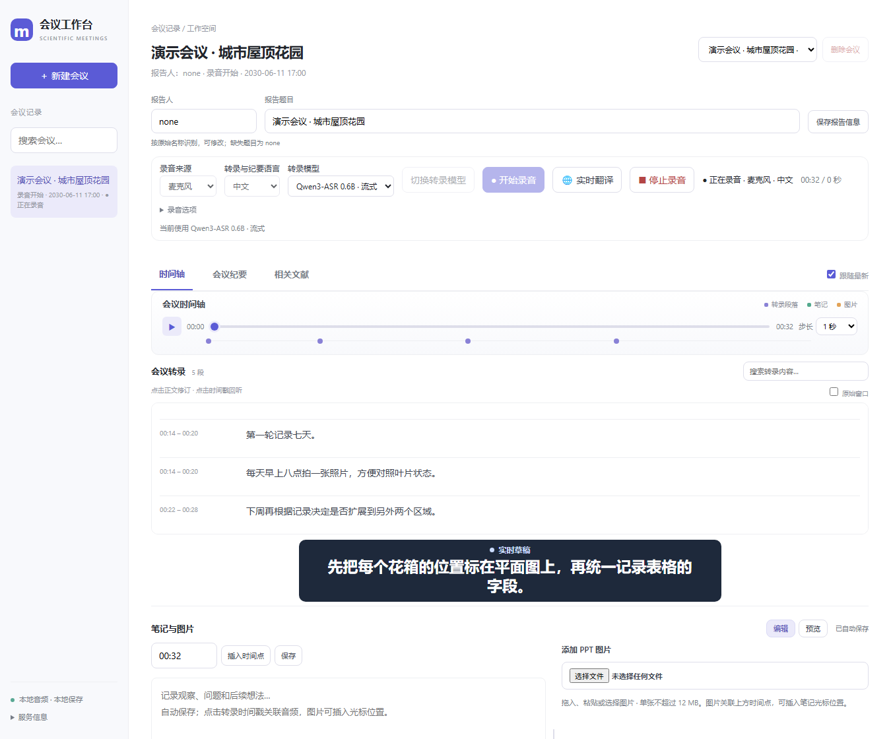
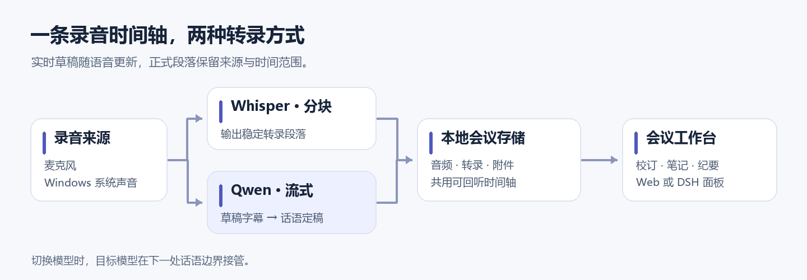

# DSH-meeting

本地优先的科研会议工作台。把麦克风或 Windows 系统声音转成可回听、可校订的文字，沿时间轴记笔记，并整理为会议纪要。可以独立在浏览器中使用，也可以接入 DeepSeek Harness 的 Meetings 面板。



*上图由实际界面渲染，标题、转录与时间均为虚构演示。*

## 两种转录方式

| 后端 | 显示方式 | 回听与时间信息 |
| --- | --- | --- |
| **faster-whisper** | 分块识别，显示稳定段落。可用 CPU，支持配置 Turbo 及其他模型 | 可开启词级时间戳估计。工作台按段落来源窗口回听 |
| **Qwen3-ASR-0.6B** | GPU 流式识别。讲话时显示可更新的底部字幕，话语结束后提交定稿 | 定稿附录音区间，用于跳转回听 |

开录前可选模型。录音中切换时，目标模型先准备，在下一处话语边界接管同一条录音时间轴。Qwen 实时草稿单独显示，正式转录进入搜索、修订、导出和纪要流程。首版按时间段组织转录。发言人分离、角色识别与姓名校订仍在验证范围内。



## 快速开始

需要 Windows 10 或 11、Python 3.12+ 和 PowerShell。以下命令从仓库根目录执行。先下载语音模型，再启动工作台。录音前请取得参与者同意。

```powershell
git clone https://github.com/Protonhydrogen/DSH-meeting.git
Set-Location DSH-meeting
$runtime = Join-Path $env:LOCALAPPDATA 'DSH-meeting'
py -3.12 -m venv (Join-Path $runtime 'venv')
$python = Join-Path $runtime 'venv\Scripts\python.exe'
$env:PYTHONPATH = (Resolve-Path 'src').Path
& $python -m pip install -r requirements.txt
& $python scripts/fetch_models.py --whisper small
& $python -m scientific_conference --config config/example.yaml live --open-browser
```

打开工作台后，新建会议，选择「麦克风」或「系统声音」，确认语言与模型后开始录音。点击文字可校订，点击时间戳可回听。在时间轴下方可以保存笔记和随时间定位的图片。

想升级到 Whisper Turbo，运行 `scripts/fetch_models.py --whisper turbo` 下载模型，再把 `asr.model` 设为 `turbo`。要保存自定义设置，可把 `config/example.yaml` 复制为 `config/local.yaml`，后续启动时使用该文件。

## 集成、配置与数据

- **Qwen 流式服务**需要单独的 Linux 或 WSL2 NVIDIA GPU 环境。安装后在转录模型中选择「Qwen3-ASR 0.6B · 流式」。[配置步骤](docs/setup.md#qwen-流式后端)
- **DeepSeek Harness 插件**提供原生侧栏对话、「学术报告」「常规讨论」纪要模板和逐次文件操作审批。[安装步骤](docs/setup.md#deepseek-harness-集成)
- **默认本地处理**。录音、SQLite、笔记和附件保存在 `project.output_root`，默认是 `./meetings`。预下载模型时会联网。启用云端纪要或云端转录需要单独修改配置，并根据会议情况获得授权。[配置说明](docs/setup.md#数据与网络)
- **CLI / MCP**。同一套存储和录音服务也可通过 `python -m scientific_conference --help` 与 stdio MCP 使用。[命令示例](docs/setup.md#cli-与-mcp)

## 许可证

本仓库原创代码和文档采用 [MIT 许可证](LICENSE)。运行时、模型和依赖由各自上游提供，并适用各自的许可证。模型权重需单独获取。
